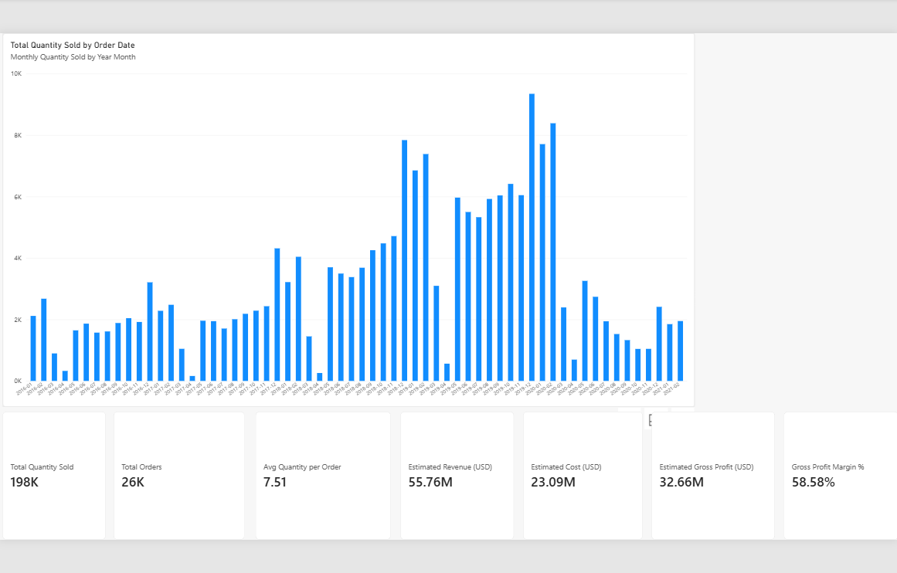
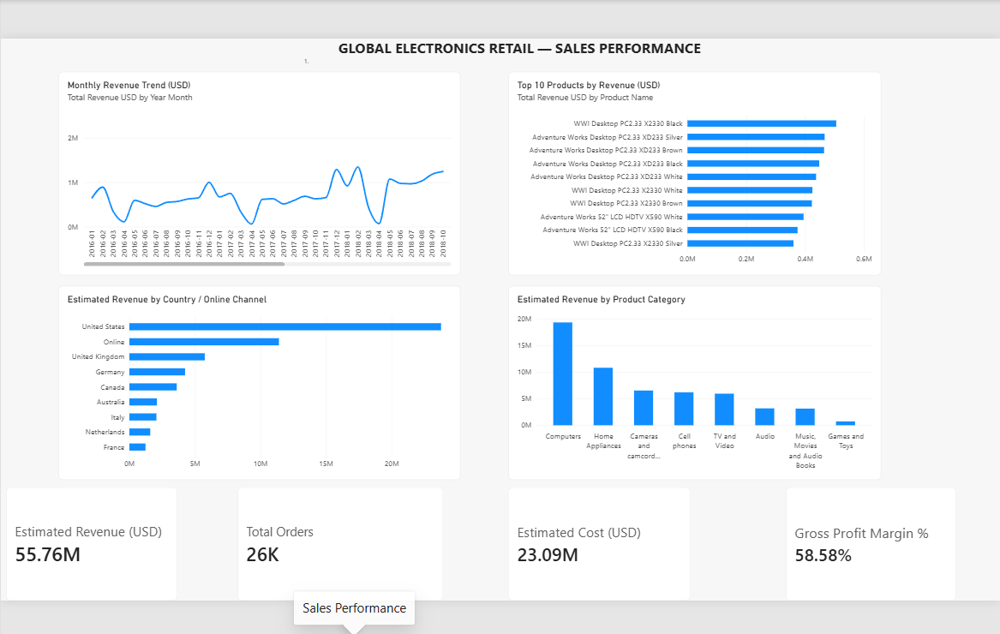
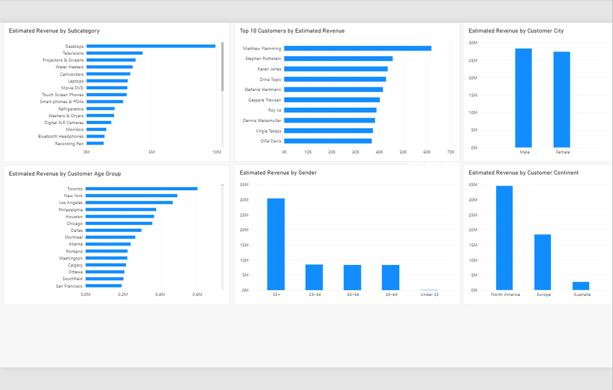
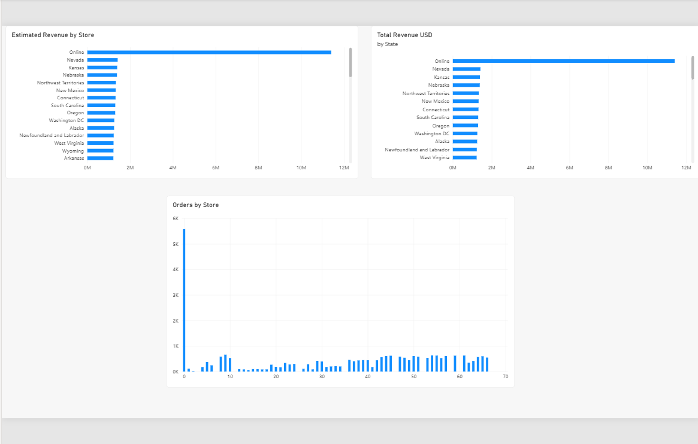

# Global Electronics Retail Analysis — Power BI

## Project Overview
An interactive Power BI dashboard analysing sales performance, product categories, customer demographics, and store-level activity for a global electronics retailer.

## Objectives
- Analyse monthly sales and quantity trends.
- Identify high-revenue products and categories.
- Explore customer demographics and geographic patterns.
- Compare revenue and order volume across stores.
- Calculate estimated revenue, cost, gross profit, and gross profit margin.

## Tools Used
- Microsoft Power BI Desktop
- Power Query
- DAX
- Data modelling and visualisation

## Key Metrics
| Metric | Value |
|---|---:|
| Estimated Revenue | $55.76M |
| Estimated Cost | $23.09M |
| Estimated Gross Profit | $32.66M |
| Gross Profit Margin | 58.58% |
| Total Orders | 26K |
| Total Quantity Sold | 198K |

*Revenue and cost are estimated using quantity multiplied by listed product unit price and unit cost. Values are rounded as displayed in the report.*

## Dashboard Pages
1. Quantity Analysis
2. Sales Performance
3. Product & Customer Insights
4. Store & Operations

## Data Preparation and Analysis
- Cleaned and transformed data types using Power Query.
- Created relationships between sales, products, customers, stores, and exchange rates.
- Developed DAX measures for revenue, cost, gross profit, gross profit margin, order count, and quantity sold.
- Created customer age groups for demographic analysis.

## Preliminary Observations
- Computers have the highest displayed revenue among product categories.
- Monthly revenue varies throughout the displayed period.
- The dashboard supports comparisons across products, customers, and stores.

## Project File
The Power BI report (`.pbix`) and dashboard screenshots will be included in this repository.

## About
This is a portfolio project demonstrating data preparation, data modelling, DAX calculations, and business intelligence reporting using Power BI.

## Dashboard Screenshots

### 1. Quantity Analysis

### 2. Sales Performance

### 3. Product & Customer Insights

### 4. Store & Operations

